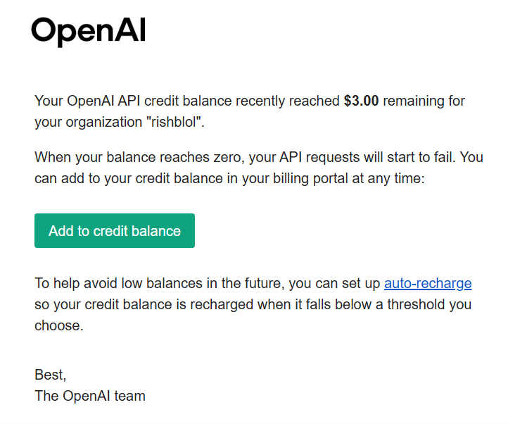

## Introduction

Holy airball it's been a while since I've written any blogs, but atleast I found some incentive to do so now. 

Coming to the topic itself, I feel we've all come across AI and it's various forms and we've used them in different ways, let it be the app interface, terminal ui etc etc.
Now, the initial fascination of it completing your research papers from slopping the theoretical parts which you couldn't bother writing to now planning and then developing entire
projects at a stretch seems very surreal, given when decent-level LLMs were launched for public usage, we never expected it scale in such a manner. 

I will admit, I was one of those individuals who was fascinated by this and that time we had the Github student plan where we have very high limits with the top-tier models of that
time (think it was sonnet 3.5 or 4 not sure), I thought of giving AI a shot at helping me finish an endsem project at that time, since I wasn't really interested in giving enough effort to it.

Long story short, I was using API keys to call on LLMs and I was calling upon GPT-4o-mini to do the system rating
since the rate per API call was dirt cheap and just needed a 'novelty' in my project.

## The Problem
Now, fast-forward to 2026, I get a mail from OpenAI saying that I have $3 in credit remaining. 

I was a bit confused, since it was a while since I used the API dashboard to manage and use keys and I thought this would have been a reminder mail, so I didn't bother and 
continued doing my work as usual.

Then I opened the dashboard a while later and see that there's $0 left in my credit balance. Now how did that happen?

Then it hit me that the API key used in my project were still there as plaintext on my code repo which was a public repository. 
I went to my repo to verify that and yeah, it was there as plaintext. Stupid me did not bother making a .env for storing such keys
and instead 'relied' on the agent that this is all fine and there's nothing to be worried about.

## Security lapse and concerns
Now, this is a very small thing, and thank you to anyone using those API keys since I had to burn whatever credit I had left in the dashboard.

But think about production systems, which are running live and might be using such API keys to call on LLMs for such functionalities.
Anyone viewing public code repositories can exploit this and organizations can lose upto thousands of dollars on such APIs without
them ever knowing what went wrong.

## Conclusion
Of course, in the big 26 AI has become this capable that it wouldn't make such blunders (hopefully) but on a developer point of view,
understanding and reviewing code has become more important than ever and with such drastic changes in this industry day by day, we have to be
at some pace such that we don't make such mistakes, whether these are production level systems or your projects you do for your interest.

Hence, don't blindly rely on AI slop. It will cost you dearly.
